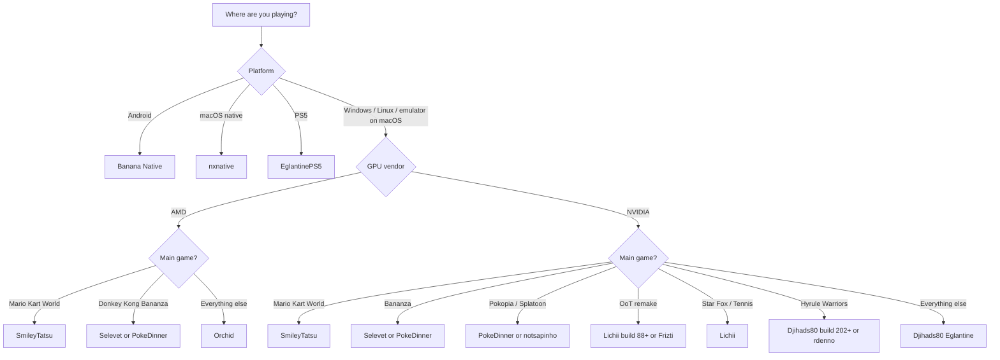

# Which Forks?

A use-case guide to Nintendo Switch 2 emulator forks and adjacent native ports: which build to pick for your GPU, OS, and the game you want to play.

[](#update-log)
[](LICENSE)
[](CONTRIBUTING.md)

> [!WARNING]
> Everything here is experimental. Builds land several times a day, regress without notice, and fork rankings depend on the game and driver. "Best" below means "best documented starting point for that use case on 7 Nov 2026", nothing more.

Official Eden does not support Switch 2 in its stable release. The Switch 2 builds here are community forks, not Eden team releases.

The page is ordered by what people ask first: which fork to use, what has been tested, then setup and trust checks.

---

## Which fork should I use?

| Your situation | Start here | Why |
|---|---|---|
| Windows/Linux, NVIDIA, first install | [**Djihads80/Eglantine**](https://github.com/Djihads80/Eglantine/releases) ★ | The central upstream: most tested, most builds, all-round compatibility |
| AMD GPU (RDNA2+) | [MythosOfs/Orchid](https://github.com/MythosOfs/Orchid/releases) | Independent fork with AMD-focused shader and GPU fixes; developed on an RX 9070 XT |
| Mario Kart World above all | [SmileyTatsu/Eglantine](https://github.com/SmileyTatsu/Eglantine/releases) | Recent builds 11/12; 45-50 FPS average and near 60 on AMD docked in independent reports |
| Donkey Kong Bananza | [selevet-eglantine](https://github.com/sylvieistaken/selevet-eglantine/releases) or [PokeDinner](https://git.eden-emu.dev/Franseven/PokeDinner-a-Eglantine-Fork/releases) | Selevet: 30 FPS cap and 60 smooth motion; PokeDinner 2.5: 30 FPS option on AMD |
| Pokémon Pokopia | [notsapinho/Eglantine](https://github.com/notsapinho/Eglantine/releases) or [PokeDinner](https://git.eden-emu.dev/Franseven/PokeDinner-a-Eglantine-Fork/releases) | Both list Pokopia as a target; notsapinho calls it playable |
| Splatoon Raiders | [PokeDinner](https://git.eden-emu.dev/Franseven/PokeDinner-a-Eglantine-Fork/releases) | Textbox, texture and HDR fixes |
| Online play (MKW, Splatoon Raiders) | [Droplet](https://gitlab.com/seighttt/droplet/-/releases) | Private Reservoir servers for online and LAN; emulators only |
| Zelda OoT remake, Star Fox, Mario Tennis | [**zortos293/Lichii**](https://github.com/zortos293/Lichii/releases) ★ | Lichii for all three; Frizti v1 for OoT visual fixes on Windows |
| Hyrule Warriors: Age of Imprisonment | [Djihads80 build 202+](https://github.com/Djihads80/Eglantine/releases) or [rdenno](https://github.com/rdenno/Eglantine/releases) | Build 202 was the Hyrule Warriors fix set (46-49 FPS median reported) |
| Android 13+, Snapdragon 12 GB+ | [Banana Native](https://github.com/moceure/BananaNative/releases) | Native port, not an emulator; DK Bananza works, Pokopia about 60 FPS, MKW in progress |
| macOS, native port | [nxnative](https://github.com/seedds/nxnative) | Switch 2 games as Mac apps from a NUP; no emulator; source-only build |
| PS5 | [heydemoura/EglantinePS5](https://github.com/heydemoura/EglantinePS5) | Experimental PS5 port of Eglantine |
| Zen 3 CPU, chasing FPS | [selevet-eglantine](https://github.com/sylvieistaken/selevet-eglantine/releases) | PGO + ThinLTO build tuned for Zen 3 |
| MKW, frame generation, 30 FPS lock | [ZendNevs/Eglantine-ZendNevs](https://github.com/ZendNevs/Eglantine-ZendNevs/releases) | FSR 3 / LSFG, DynamicFPS, 30 FPS lock; release-only repo, so verify the source |

If you only read one line: install **Djihads80/Eglantine** ★ first. Switch forks only when a specific game or your GPU is broken, and keep the build that worked.

---

## Stats at a glance

123 reports, 14 games, 68 CPU/GPU pairs, and 60 reports in the 3-6 Nov window used for the first picks. 63 reports are NVIDIA, 37 AMD, 6 Steam Deck, and 17 have no named GPU.


The full [coverage page](docs/COVERAGE.md) has the game-by-GPU, game-by-CPU, build and setup tables. The normalized data is in [data/performance-reports.json](data/performance-reports.json).

---

## Decision tree



The tree covers offline play. For private online Mario Kart World or Splatoon Raiders, see Droplet below.

---

## Confidence legend

Claims here are labelled, because the scene is full of "60 FPS trust me bro":

| Label | Meaning |
|---|---|
| Documented | The fork's README or release notes state it. |
| Corroborated | Two or more independent [experience reports](docs/REPORTS.md) on the same game, fork and GPU class agree. |
| Community-reported | Comes from public community posts from 30 Oct to 6 Nov 2026 or third-party posts; not independently reproduced here. |
| Source-only | No prebuilt binary at check time; build it yourself. |

---

## The forks

### Djihads80/Eglantine: the central fork ★

Runs on Windows, Linux and macOS, with NVIDIA, AMD and Intel GPUs. Claims here are documented.

The reference **Eglantine** build, derived from Eden, Yuzu and Sudachi and started by Camille LaVey. At check time it had 5.1k stars, GPL-3.0, the daily-20261107 build (7 Nov 2026), pre-release build-212 (4 Nov) and a v0.1.0-rc1 tag. Recent builds added NUP packaging (135), rumble (168) and DLSS through Streamline (189).

The daily branch now has the OoT startup fix (PR #567, merged 4 Nov) plus a large set of OoT rendering, shader and recommended-settings commits. Daily builds still showed a black 3D world for some testers, and the newest fixes are not in a stable release. Do not treat Eglantine as the OoT pick yet; Lichii has the longer released-build record.

Stability is split. One tester reports 202 to 212 force-closing and calls 196 their last stable, while another reports 212 working after a rebuild. Build 202 was the Hyrule Warriors fix set. The rc1 tag is slower than build 212 for several testers; Fire Emblem went from 50+ to 8-10 FPS on an RTX 30 card. Star Fox still fails to load on Eglantine (issue #533); a compatibility fix merged on 6 Nov was reverted seconds later. Build-by-build notes are in [project notes](docs/PROJECT-NOTES.md).

Start here if you want the default, the widest game coverage, and the build most forks rebase on. One caveat: "stable" is relative here. These are pre-releases, so pin a build that works for your game and don't update mid-playthrough.

### SmileyTatsu/Eglantine: Mario Kart World specialist

Windows, Linux and macOS builds for AMD and NVIDIA. Documented.

A fork of Djihads80 with pipeline-cache changes, guest-RAM release work and a Mario Kart World frame-rate fix that are not all merged upstream. Latest at check: build-16 (5 Nov 2026), 10 release assets. The fork's README still points to upstream for downloads, but its own Releases tab is populated.

This is the one if Mario Kart World is your main game, on either GPU vendor. The catch: it is a small fork (6 stars) moving fast, so changes may be rebased or dropped.

### MythosOfs/Orchid: AMD and independent

Windows and Linux builds, plus an experimental macOS arm64 build. AMD only. Documented.

Started as an Eglantine fork and now independent. It adds Ampere shader-instruction lowerings, Switch 2 font handling, kernel thread-race fixes, and graphics fixes for texture copies, descriptor buffers and geometry shaders. Latest at check: v0.7.4 (5 Nov 2026), GPL-3.0, with Windows zip, Linux AppImage and tar.gz (PGO variants), and an experimental macOS 15+ arm64 build.

Ocarina of Time is the current focus: v0.7.2 brought gameplay rendering, v0.7.3 fixed exposure, haze and sky ambient light, and v0.7.4 restored trees, bushes, vines and grass. The exposure and fog change is a visual workaround; it also thins fog in interiors and can be disabled with `EDEN_NX2_OOT_VISUAL_WORKAROUND=0`. No FPS report for OoT on Orchid was available at check time.

If you want the OoT fog, exposure and vegetation fixes, try v0.7.4; performance on OoT is still unmeasured.

Go for Orchid if you're on AMD. The performance table was measured on a 5800X3D with an RX 9070 XT and Mesa RADV from git, with 60 FPS reported in Mario Tennis Fever and Super Mario Bros. Wonder, and 30-40 FPS in MKW with asset glitches. Keep in mind: release builds can lag commits, so self-build for the newest code.

### PokeDinner (Franseven): the game-specific lab

Windows, Linux and macOS builds. The author warns about AMD GPUs. Documented.

Hosted on the Eden Forgejo. Release notes read like a per-game changelog: initial OoT support, Splatoon Raiders textboxes, textures and HDR, MKW "now goes ingame", Donkey Kong terrain fixes, Pokopia invisible items, sky and reflections, and initial but not ready Fire Emblem Fortune's Weave support. Latest tag 2.7.7 is Windows-only and explicitly broken/experimental; 1.x and 2.0.0 tags include Linux AppImage and macOS arm64.

PokeDinner is a compatibility lab, not the default performance pick. Use it when a game boots or renders better here. PokeDinner 2.5 with the 30 FPS option is a recent DK result on AMD; Selevet is the other recent option. The catch: the author asks for a 32 GB pagefile or swap plus 12 GB DRAM, and only one dynamic or 30 FPS lock can be active at a time.

### notsapinho/Eglantine: Pokopia build

Windows x64 and Linux x86_64/arm64 builds. Documented.

An independent Eglantine-based build. Every push to `main` is published. Latest at check: build-11 (4 Nov 2026). The README lists Pokopia as playable, plus MKW and Splatoon Raiders. x86_64 builds require AVX2 (Haswell or newer, or Ryzen).

Choose it if Pokopia is the goal and you want a simpler build than PokeDinner. Downside: it is a very small project (5 stars), so expect crashes and glitches.

### zortos293/Lichii: game-patch fork ★

Windows, Linux and macOS builds for NVIDIA and AMD. Community-reported.

A large **Eglantine**-derived fork (4.7k stars) that also handles Switch 1 titles. Latest at check: release tag build-94, called build-95 in the app (7 Nov 2026). The tag and the in-app number disagree because the workflow numbers runs, not tags; they are the same build. The Releases page now has Windows, Linux x86_64/aarch64 and macOS arm64 assets. The README still points downloads to the old zortos293/Eglantine releases page, so use the Lichii releases tab.

Build 80 (5 Nov) was the first build with wide OoT community reports. It was published as an Actions artifact while Releases still showed build-75. These field reports describe build 80:

- On a 9800X3D, players report about 54-60 FPS, with heavy bloom, sunrays, texture flicker and intermittent black-screen flashes.
- An i3-10100 with an RTX 3060 12 GB and 24 GB RAM gets 20-24 FPS in Kokiri Forest.
- A 3080 10 GB gets 40-50 FPS in Kokiri Forest and 40-60 inside the Deku Tree, with CPU and GPU both under 50%. That points to the emulator, not settings.
- An RTX 2070 with a 9800X3D reportedly holds 60 FPS, while a 7900 XTX with a 13400F does not. CPU single-core speed looks like the limiting factor.
- For black screens, try the non-PGO Windows build first; the PGO build caused black screens for several users. Docked mode helped some setups. Some cutscenes stay black with audio only.

Build 88 (6 Nov) integrated Frizti's performance ports, added background pipeline preparation, fixed FSR3 frame generation and bundled Dark's Dynamic FPS mod for OoT, enabled by default. The developer reports 60 FPS; outlets and users saw 60 FPS in opening areas on RTX 4080/5080/5090-class cards. The only i3-10100 and RTX 3060 number available is from build 80: 20-24 FPS. Build 93 (6 Nov) added AMD shader and Vulkan synchronization fixes, but they have not been verified in affected AMD gameplay. Build 94/95 (7 Nov) fixes OoT near foliage, white flashes, terrain drawn over the scene, the Z-target reticle and several rejected shaders; the release notes say these changes had limited gameplay testing.

Radeon remains the weak spot. Build 93 targeted AMD shader and Vulkan issues, but its release notes still list black textures, haze, HUD flicker and cutscene audio as open investigations. A 60 FPS clip is usually a high-end RTX card in an opening area, not a sustained result.

Lichii keeps Eden/Eglantine data folders, so saves are shared. The shader cache is shared too; if a build hangs at "Loading Shaders" after switching forks, delete that game's shader cache folder. The README asks for crypto donations, so only use addresses copied from the real repo.

**Lichii** is the pick if you want OoT remake or the other titles attributed to it, and you have a fast CPU. Use build 88 or newer; build 94/95 has the latest visual fixes. On Windows, Frizti v1 adds another set of OoT visual fixes; see the next section. Before you download: check the release or commit notes of the build, and remember that Actions artifacts are not releases. Keep the zip if a build works. The project still uses the historical "Eglantine" name internally.

### Frizti/Lichii: Ocarina of Time visual fixes

Windows x64 only. GPL-3.0, source in repo. Community-reported performance.

A fork of zortos293/Lichii focused on OoT. Frizti v1 (5 Nov 2026) removes the one-frame white flashes on Link and the scene, adds a built-in Max Resolution patch so the 3D no longer sits at the 854x480 dynamic-resolution floor, and includes culling, vegetation, grass and fog fixes.

It is Windows x64 only; there is no Linux or macOS build. The game is capped at 30 FPS without the Dynamic FPS mod, and shader compilation causes heavy stutter. Build 88 bundles the mod, but frame pacing and game speed are not fully verified. AMD users report black screens and GPU driver crashes; one community workaround is to add `EDEN_NX2_REJECT_HASH=e40561a7a0f7a0b3` to `%APPDATA%\eden\nx2_switches.txt` and restart.

Frizti's performance work is now part of Lichii build 88: cached storage-buffer bindings, direct uniform uploads, batched readbacks and Dark's Dynamic FPS mod. Lichii credits Frizti for those ports, and some 60 FPS OoT footage comes from Frizti's own builds. Frizti v1 remains the Windows visual-fix build, not the main performance fork.

Pick it for OoT on Windows if visuals matter more than cross-platform support. Use Lichii build 88 or newer for Linux or macOS, or Orchid v0.7.4 for its exposure and fog work.

### Droplet: private online servers

Windows 10/11 and Linux. NVIDIA and AMD. Documented.

Droplet is a modified eden-nx2 build with Eglantine and PokeDinner work, focused on Splatoon Raiders and Mario Kart World. It adds Reservoir, a private replacement for Nintendo's NPLN service. The emulator redirects server calls to a server you host, with friend codes, matchmaking, rooms and room IDs, without modifying game binaries. Online play is emulator-only for now; real hardware cannot join.

Reservoir is the server branch of the same GitLab project and runs with Docker Compose:

```bash
git clone -b server https://gitlab.com/seighttt/droplet.git reservoir
cd reservoir
cp .env.example .env
docker compose up -d
docker compose exec reservoir set-admin-password
```

The [server README](https://gitlab.com/seighttt/droplet/-/tree/server) lists the ports to open (8443, 8444, 3478/3479, 10025, 10125, 33334, 34343). Keep the admin panel on 127.0.0.1:8090; it is plain HTTP. Droplet 0.1.2 and later fetch the server certificate automatically. The project runs no official servers and no official community chat; every Reservoir server is independent.

At check time the v0.1.2 tag exists but GitLab has no v0.1.2 binary release. The v0.1.1 Windows and Arch Linux binaries are still online, marked old/outdated. Build from source for v0.1.2; Windows uses MSYS2, and the Linux binary only targets Arch-based systems.

Droplet is stricter than most forks: it cannot load keys or encrypted NCA, NAX, NSP or XCI files, and runs decrypted folders, NRO, NSO and KIP files only. It never connects to Nintendo's servers.

Use it for private online Mario Kart World or Splatoon Raiders with people you trust. Switch 2 online play is peer to peer, so players can see each other's IP addresses; host on a network you control and invite only people you trust. Online CameraPlay and GameChat are not supported. Splatoon Raiders sometimes turns the top of the sky black after loading the beach, and NUP-packed games run slower than folder dumps. The announcement describes the work as AI-assisted, so read the source if that matters.

### rdenno/Eglantine: nx2-merged and Hyrule Warriors

Windows, Linux and macOS builds for NVIDIA and AMD. Community-reported.

A fork of Djihads80 with an `nx2-merged` branch and its own builds (build-8, 4 Nov 2026, 10 assets). Hyrule Warriors: Age of Imprisonment improvements landed upstream around build 202, so this is another way to get that fix set, not a separate magic build.

Useful if you want a second build to compare against upstream for Hyrule Warriors. The catch: it is a tiny fork (4 stars) with no game list in the README.

### ZendNevs/Eglantine: frame generation and a release-only repo

Windows only, for NVIDIA and AMD. Release notes documented, repo history minimal.

An Eglantine fork that merges Eglantine build-104, PokeDinner and Selevet Eglantine into one build. The "3 builds in 1" label means those three codebases, not three executables. It adds FSR 3 and LSFG frame generation, DynamicFPS and a 30 FPS lock. Latest at check: v2.0.5 (3 Nov 2026), 100 stars, Windows only.

The release notes document results on a Ryzen 5 5500X3D, RTX 4070 and 16 GB: MKW about 56 FPS average and 44-50 in the lowest 10% in 1x handheld with DynamicFPS; Donkey Kong Bananza about 33 FPS average, 20.6 low, with game speed at 99%. Pokopia startup reached 60 FPS, and frame generation took the display to 116-120 FPS.

Repo check: at the time of writing the GitHub repo has 2 commits, no license, and a README that only claims Mario Kart World testing. The DK and Pokopia results come from release notes and user praise, not from a long public history. The release assets include a source zip. Treat it as a release-only fork and verify the source before trusting it.

It is an alternative for MKW or DK if you want DynamicFPS or frame generation. Recent independent reports favor SmileyTatsu for MKW and Selevet or PokeDinner 2.5 for DK. One caveat: DK still has hitches up to 0.6 seconds, frame generation adds latency, and the build shares settings with other Eden and Eglantine builds in `%APPDATA%\eden`. Back that folder up or use a separate user folder. No license is declared, so check before redistributing.

### Anka: Windows performance fork (experimental)

Windows 10/11 x64, NVIDIA/AMD/Intel through Vulkan. GPL-3.0, full source in the repo.

Anka is a new emulator built on Eden, Eglantine/PokeDinner, yuzu and Sudachi. It is not an official release of those projects, and the author asks for bug reports in its own tracker. Latest at check: anka-v1.0.0 (6 Nov 2026), 7 stars, one release. It is portable and ships its Qt and Visual C++ DLLs. The release also has three source zips, a PDB and SHA256SUMS.txt.

The project measured Donkey Kong Bananza on one PC: Ryzen 7 5700X, 64 GB RAM, RTX 4060 Ti, 1440p 170 Hz. It reports 42-53 FPS uncapped and 39-46 FPS with the dynamic frame rate patch in the opening and open area, against 17.3 FPS for PokeDinner 2.0.0 in the heaviest view. The README calls this a rough indication, not a controlled A/B. Only DK was measured, and AMD, Intel and other CPUs were not tested.

The presets are Recommended, Recommended + Reactive Flushing, Safe and Custom. GPU Mode starts at Fast (Low); use Accurate if a game shows image errors. Frame generation is FSR3 with Off, 2x and Dynamic choices. start-recommended.bat is the main launcher, start-safe.bat is for troubleshooting and other games.

Caveats: one release, 7 stars, one measured game and one PC, and most code and commit messages are AI-assisted under the maintainer's direction. There are no independent reports yet. Treat the DK numbers as a promising self-report, not a verified first pick. The DK pick remains Selevet perf 3/4 or PokeDinner 2.5.

### nxnative: macOS native port

macOS 26.6+ on Apple silicon. MIT, source in repo. Not an emulator.

nxnative runs the game's own code on the Apple chip and rebuilds NVN on Metal. It is the macOS counterpart to Banana Native. Switch 2 support started on 31 Oct; the README lists Donkey Kong Bananza, Splatoon Raiders, Fire Emblem Fortune's Weave, Pokemon Pokopia, Hyrule Warriors: Age of Imprisonment, Mario Kart World and Mario Tennis Fever. Mac only.

It builds a Mac app from one .nup file or a game folder, and the NUP path does not need prod.keys. Requirements are macOS 26.6+, Xcode 27.2, Homebrew and Python 3.12+. The first build takes 30-60 minutes and needs about twice the game size plus 10 GB free. There are no prebuilt releases; build it yourself.

Pick it if you have an Apple silicon Mac and want a native app. The catch: source-only, one platform, seven Switch 2 games listed, and iPhone/iPad are untested for Switch 2. For a normal emulator on macOS, use an Eglantine-based fork such as Lichii.

### Banana Native: Android native port

Android 13+, Snapdragon/Adreno, 12 GB RAM. Source in repo. Not an emulator.

Banana Native is not an emulator and not a fork. It runs the game's own ARM64 code on the phone and rebuilds the NVN graphics on Vulkan. It is an Android port of nxnative. The former moceure/eden-nx2-android emulator is unmaintained and now points here.

Latest at check: v0.1.5 (5 Nov 2026), 325 stars, MIT repository license. Donkey Kong Bananza works at about 30 FPS, Pokopia runs at about 60 FPS, and Mario Kart World is in progress with graphics problems. Only the listed game versions run.

It needs your own dump as a folder, with base, updates and DLC. No keys or firmware. Preparation takes 10-15 minutes on a Mac or about an hour on the phone; MKW needs a Mac. It was tested on one phone, a Snapdragon 8 Elite Gen 5 with 16 GB, so other phones are unverified.

Pick it if you have a recent Snapdragon phone and want native performance without an emulator. The catch: experimental, one tested phone, a black sky in Pokopia, texture glitches in DK, graphics problems in MKW, and heavy heating.

### Other forks worth knowing

Lower confidence, but relevant depending on hardware:

| Fork | Platform | Why it exists | Confidence |
|---|---|---|---|
| [selevet-eglantine](https://github.com/sylvieistaken/selevet-eglantine/releases) | Windows/Linux | Zen 3-tuned, PGO + ThinLTO, faster GPU mapping. 121 stars. Build 6 (3 Nov). | Documented |
| [EddizEge/Anka](https://github.com/EddizEge/Anka/releases) | Windows 10/11 | New DK-focused performance fork. 7 stars, one release; the DK result is a single-PC self-report. | Documented |
| [Kradnah/Firefly](https://github.com/Kradnah/Firefly/releases) | Windows 10/11 | OoT-focused Lichii fork. Build 18 (7 Nov) picks a 60 FPS, 30 FPS or maximum-performance profile from your GPU memory and CPU; the 30 FPS profiles keep the game at normal speed. Self-reported on a 4600H with an RTX 3050 Laptop 4 GB: steady 30 indoors, 15-22 FPS in the busiest areas. NVIDIA only, 0 stars, AI-assisted commits disclosed. | Documented |
| [heydemoura/EglantinePS5](https://github.com/heydemoura/EglantinePS5) | PS5 | Experimental PS5 port. 195 stars. GPL-3.0. Source only, no release assets at check. | Community-reported |
| [astralbeexd/Eglantine-3060Ti-16GB](https://github.com/astralbeexd/Eglantine-3060Ti-16GB) | Windows | Patch set plus a binary release, not a full source tree. 11 stars. | Unverified |

A missing license or a source zip without a source tree matters: ZendNevs declares no license and publishes source only as a release zip, while the 3060Ti build is a patch set with a binary release. Both stay out of the first picks. See the [source audit](docs/SOURCE-AUDIT.md).

---

## Which fork for which game

| Game | First pick | Also try | Evidence |
|---|---|---|---|
| Mario Kart World | SmileyTatsu | Djihads80; Orchid (AMD); ZendNevs (release-only, caution) | Smiley build 11/12 recent reports; ZendNevs 56 FPS is self-reported from a 2-commit repo |
| Mario Kart World (online) | Droplet + Reservoir | SmileyTatsu for offline | Private NPLN replacement, self-hosted server, emulators only |
| Donkey Kong Bananza | Selevet perf 3/4 or PokeDinner 2.5 | ZendNevs (release-only, caution); Lichii | Selevet: 30 cap and 60 smooth on 5700X3D/5070Ti; PokeDinner 2.5: 30 FPS option on 9600X/6800 |
| Pokémon Pokopia | notsapinho | PokeDinner | notsapinho: 120fps mod and 80+ FPS on an RTX 4060 Mobile; PokeDinner for invisible-item and sky fixes |
| Splatoon Raiders | PokeDinner | Djihads80; notsapinho | PokeDinner textbox, texture and HDR fixes; upstream says variable performance |
| Splatoon Raiders (online) | Droplet + Reservoir | PokeDinner for offline | Private NPLN replacement; sky bug after beach load |
| Zelda: OoT remake | **Lichii build-88+ or Frizti v1** | Orchid v0.7.4; PokeDinner | Lichii for cross-platform; Frizti v1 for OoT visual fixes on Windows; Dynamic FPS mod, frame pacing and shader stutter still need testing |
| Star Fox | **Lichii** | Djihads80 | Community-reported |
| Mario Tennis Fever | **Lichii** | Orchid | Community-reported; Orchid measured 60 FPS |
| Hyrule Warriors: AoI | Djihads80 build 202+ | rdenno nx2-merged | Build 202 fix set; 46-49 FPS median reported |
| Super Mario Bros. Wonder | Orchid | Djihads80 | Orchid reports 60 FPS (Switch 1 title) |
| Fire Emblem Fortune's Weave | PokeDinner | None | Initial support, explicitly "not ready" |

Game names are used only to describe compatibility targets. No game files, keys or firmware are hosted or linked here.

On Android, Banana Native is a native port, not an emulator: DK Bananza works, Pokopia runs at about 60 FPS, and MKW is in progress.

For MKW settings and the full performance table, see [Mario Kart World notes](docs/MKW.md).

For DK settings and build notes, see [Donkey Kong Bananza notes](docs/DONKEY-KONG.md).

For Pokopia settings and workarounds, see [Pokopia notes](docs/POKOPIA.md).

---

## Community reports: help improve the ranking

The game matrix above is a snapshot of documentation and community claims. Reports from people who actually ran a build are what turn it into a ranking that can be trusted.

There are three ways to contribute:

1. Issue form (2 minutes): [open an experience report](../../issues/new?template=experience-report.yml). Dropdowns and fields cover fork, build, game, platform, CPU, GPU, driver, RAM, settings, FPS and outcome.
2. Public thread: run [the single-thread intake script](docs/INTAKE.md) on one Reddit URL. It writes review candidates to a gitignored inbox. There is no background subreddit crawler.
3. Pull request: add a JSON file to [`data/reports/`](data/reports/README.md). CI validates it, and `scripts/reports.py render` refreshes [`docs/REPORTS.md`](docs/REPORTS.md).

How reports change the ranking:

- One report is an anecdote. It is published but does not move a recommendation.
- Two or more independent reports on the same game, fork and GPU class make a claim "corroborated". The first-pick column can then change.
- Reports with a real build tag, a log or a screenshot weigh more.
- Negative reports (won't boot, crashes) demote a fork for that game. They are as useful as positive ones.
- Configs are compared by GPU class (vendor and generation), not exact card, so one RX 9070 XT report still helps other RDNA4 users.

Reports are public. Don't post keys, firmware, ROMs or personal information.

## Setup checklist

1. Bring your own dump. You need your own game dump, `prod.keys` and firmware. None of these are included in any fork.
2. Update drivers first. Use current Vulkan drivers: Adrenalin on Windows AMD, Mesa RADV (git) on Linux AMD, and the current NVIDIA driver on NVIDIA.
3. Check RAM and pagefile. 16 GB RAM is a practical floor; PokeDinner asks for 12 GB DRAM and a 32 GB pagefile or swap. Close the browser.
4. Warm the shader cache. The first minutes stutter while pipelines compile. Never benchmark cold, and don't judge a build on the first launch.
5. Change one thing at a time: build, driver or settings. Then retest the same save and route.
6. Keep a known-good build. Zip the working folder before updating. Builds land hourly, and regressions are normal.
7. Prefer repo releases over repacks. Random "optimized" bundles are the main malware vector in this scene. Builds from GPL repos should have source available.

### Android specifics

- Banana Native requires Android 13+, a Snapdragon/Adreno GPU and at least 12 GB of RAM. It was tested on a Snapdragon 8 Elite Gen 5 with 16 GB.
- The game must be prepared once: 10-15 minutes on a Mac, or about an hour on the phone. Mario Kart World needs a Mac.
- Use the system driver or a current Turnip driver. A phone cooler helps; heat throttles hard.
- Only the listed versions run: Donkey Kong Bananza update 458752, Mario Kart World 1.8.0 base, and Pokopia 2.0.1.

---

## How to judge a fork

Forks are full emulator copies, not plugins. Before trusting one:

- Does it link upstream? A fork should name its base (Eglantine, Eden, Yuzu, Sudachi) and publish source in the repo if it is GPL.
- Does it publish real release notes? "Performance boost" with no commit or build detail is noise.
- Does it have public history? Check the commit count, license and source. A release-only repo with two commits can still ship a working build, but its claims need independent confirmation.
- Are AI-assisted commits disclosed? AI-assisted code is common here. It is not a security verdict by itself, but ask for tests, review the diffs and prefer projects that say which parts were generated.
- Is the full source in the repo? A source zip attached to a release is not a public source tree. Check `LICENSE`, `src/` and `CMakeLists.txt` or `Makefile`.
- Does it bundle keys, firmware or games? That is a red flag. Don't use it.
- Is it current? Compare its last push or release date with upstream. A fork that stopped a week ago is already stale in this scene.
- Can you reproduce the claim? Same game, same save, same route, warm cache. Otherwise treat FPS numbers as anecdotes.

### Source check

A source audit of every project in this guide is in [source audit](docs/SOURCE-AUDIT.md). All first picks publish source in the repository. Most are GPL-3.0; Banana Native is MIT on GitHub and GPL-3.0-or-later in its release notes.

ZendNevs is a different case: its repo has 2 commits, no license, and only a README plus a workflow. The source is a zip in the release, not a source tree. The 3060Ti build is a patch set with a binary release, not a full emulator fork. Neither is a first pick.

### Reading FPS claims

- "60 FPS" means nothing without the area, build, CPU, settings and duration. Menus and cutscenes are not gameplay.
- A clip from one zone on a 9800X3D is a best-case sample, not an average.
- Low GPU and low CPU usage usually means the emulator is the bottleneck, not your settings.
- Frame generation (FSR 3 or LSFG) inflates the counter; it does not raise the simulation rate.
- High FPS with flicker, bloom or black-screen flashes is still unplayable for many people.

### Recency policy

This scene changes every day. The first-pick column is based on reports from 3-6 Nov 2026 on the newest builds available at check time: Eglantine builds 196 to 219 and v0.1.0-rc1, SmileyTatsu 11/12, ZendNevs 2.0.5, Orchid 0.7.4. Older rows stay in the tables as history, but they do not drive the recommendation.

A report on an old build is not evidence for the current build. A self-reported release note from a release-only repo is weaker than an independent report on the same build. When two reports conflict, prefer the newer build and the newer report.

The reports behind these numbers, with hardware and build details, are in [performance reports](docs/PERFORMANCE.md).

Forks also vanish overnight (DMCA, renames, account deletion). If a link 404s, search the project name plus "fork" and prefer a repo that still publishes source.

---

## Legal and safety

- Emulators are legal in many jurisdictions; ROMs, keys and firmware are copyrighted. Dump your own games and don't share the files.
- This repo contains no copyrighted content and links only to public source repositories and release pages.
- These are unsigned community binaries. If you don't trust a build, build it from source or don't run it.
- Nothing here is legal advice; rules differ by country.

---

## Sources

All links checked 5-7 Nov 2026. Release metadata read from the GitHub and Forgejo APIs on the same dates.

- Central fork: [Djihads80/Eglantine](https://github.com/Djihads80/Eglantine), [releases](https://github.com/Djihads80/Eglantine/releases)
- MKW fork: [SmileyTatsu/Eglantine](https://github.com/SmileyTatsu/Eglantine), [releases](https://github.com/SmileyTatsu/Eglantine/releases)
- AMD and independent: [MythosOfs/Orchid](https://github.com/MythosOfs/Orchid), [releases](https://github.com/MythosOfs/Orchid/releases)
- Game-specific lab: [PokeDinner](https://git.eden-emu.dev/Franseven/PokeDinner-a-Eglantine-Fork), [releases](https://git.eden-emu.dev/Franseven/PokeDinner-a-Eglantine-Fork/releases)
- Pokopia build: [notsapinho/Eglantine](https://github.com/notsapinho/Eglantine), [releases](https://github.com/notsapinho/Eglantine/releases)
- Game patches: [zortos293/Lichii](https://github.com/zortos293/Lichii), [releases](https://github.com/zortos293/Lichii/releases), [build-80 Actions run](https://github.com/zortos293/Lichii/actions/runs/42021953813)
- OoT visual fixes: [Frizti/Lichii](https://github.com/Frizti/Lichii), [frizti-v1](https://github.com/Frizti/Lichii/releases/tag/frizti-v1)
- OoT performance profiles: [Kradnah/Firefly](https://github.com/Kradnah/Firefly), [build-18](https://github.com/Kradnah/Firefly/releases/tag/build-18)
- Private online: [Droplet](https://gitlab.com/seighttt/droplet), [releases](https://gitlab.com/seighttt/droplet/-/releases), [Reservoir server branch](https://gitlab.com/seighttt/droplet/-/tree/server)
- Hyrule Warriors and nx2-merged: [rdenno/Eglantine](https://github.com/rdenno/Eglantine), [releases](https://github.com/rdenno/Eglantine/releases)
- Android: [Banana Native](https://github.com/moceure/BananaNative), [releases](https://github.com/moceure/BananaNative/releases). The old [eden-nx2-android](https://git.eden-emu.dev/moceure/eden-nx2-android) is unmaintained and points here.
- macOS native: [nxnative](https://github.com/seedds/nxnative)
- Zen 3 build: [selevet-eglantine](https://github.com/sylvieistaken/selevet-eglantine), [releases](https://github.com/sylvieistaken/selevet-eglantine/releases)
- Frame-gen build: [ZendNevs/Eglantine-ZendNevs](https://github.com/ZendNevs/Eglantine-ZendNevs), [releases](https://github.com/ZendNevs/Eglantine-ZendNevs/releases)
- PS5 port: [heydemoura/EglantinePS5](https://github.com/heydemoura/EglantinePS5)

---

## Contributing

Found a fork that deserves a row, or a link that died? Read [CONTRIBUTING.md](CONTRIBUTING.md) and open a PR. Rules: one fork per PR, link the upstream repo, state platform, tested game, build and GPU/driver, and no ROM, key or firmware links.

Data lives in [`data/forks.json`](data/forks.json) and reports live in [`data/reports/`](data/reports/README.md). Run both checks before submitting:

```bash
python -I scripts/check_links.py
python -I scripts/reports.py validate
```

## Update log

| Date | Change |
|---|---|
| 2026-11-05 | Initial guide: 11 forks and 4 niche builds, release endpoints verified, game matrix from documented and community-reported claims. |
| 2026-11-05 | Broke ZendNevs/Eglantine out into its own section (frame generation, DynamicFPS, 30 FPS lock). |
| 2026-11-05 | Added community reports: issue form, JSON schema and validator, generated `docs/REPORTS.md`, CI check. |
| 2026-11-05 | Added Lichii build-80 field reports for OoT remake (Actions-only artifact, PGO black-screen workaround, CPU-bound pattern). |
| 2026-11-05 | OoT reality check and "Reading FPS claims": 60 FPS clips are area-specific, not sustained. |
| 2026-11-05 | Added Droplet and Reservoir for private online MKW and Splatoon Raiders, with build status and P2P caveats. |
| 2026-11-05 | Added `docs/PROJECT-NOTES.md` from community reports: build timeline, NUP, DLSS, rumble, Android and game reports. Removed the old discovery-section text. |
| 2026-11-05 | Added `docs/PERFORMANCE.md` with hardware, build and FPS reports for MKW, Splatoon Raiders, Pokopia, DK Bananza, Yoshi and OoT. |
| 2026-11-05 | Corrected the DK Bananza pick to ZendNevs and clarified its three merged codebases. This was later superseded by the recency review. |
| 2026-11-05 | Added Orchid v0.7.4 OoT visual fixes and noted that OoT performance on Orchid is still unmeasured. |
| 2026-11-05 | Added `docs/MKW.md` with nearly 50 MKW configs, settings notes and build regressions from community reports. |
| 2026-11-05 | Added `docs/DONKEY-KONG.md` with DK configs, 30 FPS and DynamicFPS workarounds, and terrain or purple-screen notes. |
| 2026-11-05 | Added `docs/POKOPIA.md` with Pokopia configs, black sky and 120fps workarounds, and memory limits. |
| 2026-11-05 | Added a normalized performance dataset, SVG charts and a coverage page for what was tested on which setup. |
| 2026-11-05 | Added a recency policy and downgraded ZendNevs from first pick after reviewing its 2-commit repo history. Recent independent reports now drive the MKW and DK picks. |
| 2026-11-05 | Added a source audit and a source-in-repo rule; ZendNevs and the 3060Ti build are no longer treated as auditable. |
| 2026-11-05 | Moved stats and charts to the top and reordered the page around fork choice, then data, then setup. |
| 2026-11-05 | Added recent community reports for Steam Deck, ROG Ally and low-end GPUs. |
| 2026-11-06 | Replaced the unmaintained Android emulator with Banana Native, a native Android port, and documented its supported games and requirements. |
| 2026-11-06 | Added Frizti/Lichii v1 for OoT visual fixes, with Windows-only, 30 FPS and AMD caveats. |
| 2026-11-06 | Added on-demand Reddit thread intake: one URL at a time, candidates in a gitignored inbox, human review before publishing. No background subreddit crawler. |
| 2026-11-06 | Added six recent reports from the offline archive: low-end and laptop MKW configs, the DK build 212 crash, i5-12600K with RX 9070 XT, and Orchid on RX 6950 XT. |
| 2026-11-06 | Added Anka, a new Windows performance fork, with its self-reported DK result, source audit and caveats. Not a first pick. |
| 2026-11-07 | Updated Lichii to build 88+ and build 94/95, added the Eglantine OoT and rc1 regressions, and added nxnative for macOS native builds. |
| 2026-11-07 | Added Kradnah/Firefly, an OoT-focused Lichii fork with performance profiles for laptops, with its self-reported RTX 3050 Laptop result and caveats. Not a first pick. |
